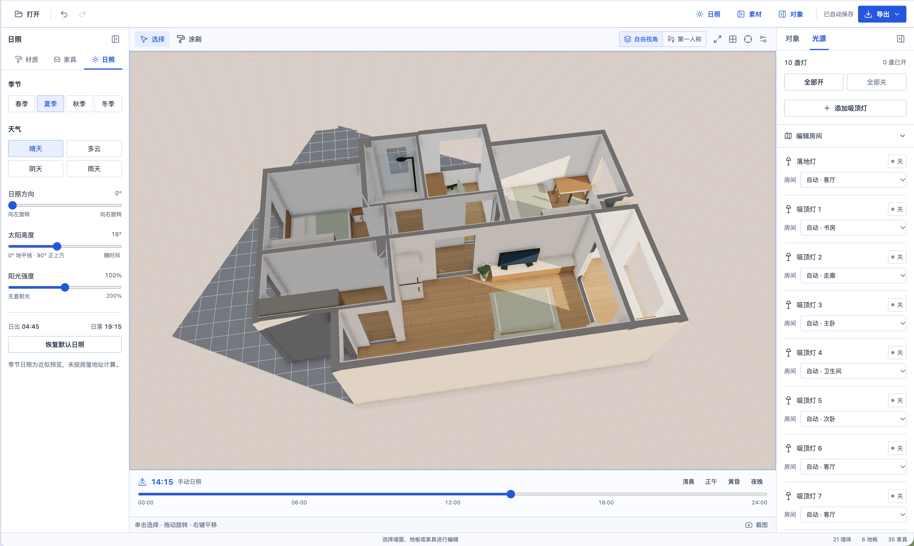
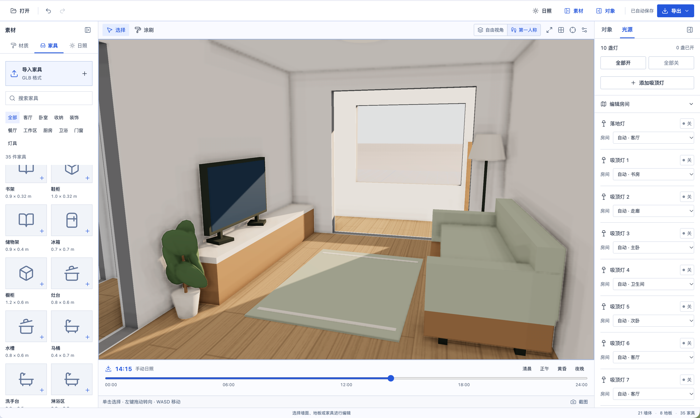
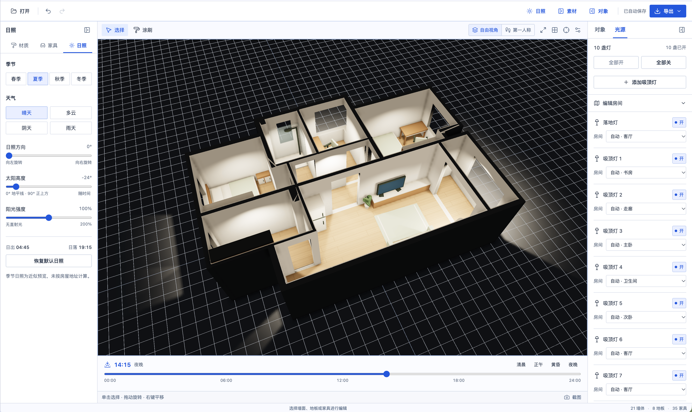

# Roomlab 装修编辑器

在浏览器里给毛坯房换材质、摆家具，再走进房间看看效果。

Roomlab 基于 React、Three.js 和 Vite，围绕扫描后整理的房屋模型进行装修试摆。支持自由视角和第一人称编辑，家具与材质采用轻量简模风格，适合比较配色、布局和光照。



## 功能

| 功能 | 支持内容 |
| --- | --- |
| 墙地面装修 | 26 种程序材质，支持换色、连续涂刷、自定义图片纹理，以及铺贴大小、方向和粗糙度调整；墙体两侧可分别编辑 |
| 家具试摆 | 35 种内置简模家具与灯具，支持搜索、分类、GLB 家具导入、移动、尺寸调整、复制与旋转；可一键旋转 90° |
| 第一人称编辑 | WASD 移动、左键拖动转向，鼠标保持自由，可继续选择墙面、换材质和摆家具 |
| 日照预览 | 时间条、四季与天气切换，可调太阳方向、高度和强度，也可恢复随时间变化 |
| 室内照明 | 吸顶灯、吊灯和落地灯支持开关，可逐灯或一键控制；支持房间归属、平面图改名及反弹光近似 |
| 保存与导出 | 浏览器自动保存、撤销重做，可导出可编辑方案 JSON、装修模型 GLB 和当前视角 PNG |

门支持左右开和鼠标悬停开关。自由视角隐藏天花板和顶部灯具外观，遮光与照明仍然生效；第一人称显示完整室内空间。

## 界面预览

| 第一人称编辑 | 夜间照明 |
| --- | --- |
|  |  |

左侧提供材质、家具和日照设置，右侧可切换“对象 / 光源”。两侧面板均可收起；对象列表高度支持拖动调整，刷新后保留。

## 本地运行

推荐使用 Node.js 20 或 22，以及支持 WebGL 2 的桌面浏览器。在项目目录执行：

```bash
npm ci
npm run dev
```

打开终端输出的地址，通常为 `http://127.0.0.1:5173`。

| 命令 | 用途 |
| --- | --- |
| `npm run dev` | 启动本地开发服务 |
| `npm run build` | 生成生产文件到 `dist/` |
| `npm run preview` | 本地预览已生成的生产文件 |

核心编辑和方案保存均在浏览器内完成，无需配置后端或 API Key。

## 基本操作

1. **装修墙面和地板**：点击表面，选择左侧材质或颜色；纹理大小、方向和粗糙度调整后，点击“应用到所选面”。开启涂刷工具后，可连续点击多个表面。
2. **放置家具**：在家具库点击模型，或导入 GLB。选中后拖动三维轴，也可以在右侧输入位置、宽深高和旋转角度。
3. **进入房间**：切换“第一人称”，用 WASD 移动、左键拖动转向。需要更换起点时，点击“选择起点”再选一块开阔地板。
4. **调整光照**：在“日照”中切换时间、季节和天气。太阳高度默认随时间变化，拖动滑杆可手动指定，点击“随时间”恢复自动；0° 为地平线，90° 为正上方。
5. **管理灯具和房间**：打开右侧“光源”，逐灯或一键开关。灯具默认按位置识别房间，也可手动指定；展开“编辑房间”，点击平面图上的区域修改名称，失焦或按 Enter 生效。

### 鼠标与快捷键

| 操作 | 自由视角 | 第一人称 |
| --- | --- | --- |
| 选择墙面、地板或家具 | 左键单击 | 左键单击 |
| 改变视角 | 左键拖动旋转 | 左键拖动转向 |
| 平移 / 行走 | 右键拖动 | WASD 或方向键 |
| 缩放 / 加速 | 滚轮 | Shift |

| 快捷键 | 操作 |
| --- | --- |
| G / R | 移动 / 旋转选中家具 |
| S | 缩放家具，仅自由视角；第一人称使用工具栏 |
| Delete | 删除选中家具 |
| Ctrl / ⌘ + Z | 撤销 |
| Ctrl / ⌘ + Shift + Z | 重做 |

## 自动保存与导出

材质、家具、门和灯具开关、房间名称与日照设置会自动保存到当前浏览器，刷新后恢复。导入的家具与图片纹理一并保存在本地。

通过顶部“导出”备份或分享方案：

| 格式 | 包含内容 | 用途 |
| --- | --- | --- |
| JSON | 材质、家具、导入资源、灯具开关、房间名称与日照设置 | 在本编辑器中继续编辑，通过“打开”恢复 |
| GLB | 装修后的模型、材质、家具、天花板与灯具光源 | 在 Blender 等三维软件中查看或继续处理 |
| PNG | 当前三维视角，不包含编辑器面板 | 保存效果截图 |

自动保存使用 IndexedDB，仅限当前浏览器和站点地址。清理站点数据会删除本地方案，更换浏览器或设备也不会自动同步；建议通过 JSON 导出留存备份。GLB 不包含网页中的日照环境、屏幕空间接触阴影和反弹光近似。

## 当前范围

- 目前接入仓库自带的户型，界面的 GLB 导入用于家具。更换房屋底座需要同步调整模型处理与表面映射。
- 房间分区来自已有地板分块，支持改名与灯具归属设置，暂不支持绘制或重新划分房间。
- 涂刷以平面为单位，暂不支持局部喷枪笔刷或纹理绘画。
- 第一人称碰撞仅针对房屋结构；家具和可开关的门暂不参与碰撞。
- 日照、季节和反弹光用于视觉预览，未按真实地址计算，也未使用完整的全局光照。自然反弹光的静态开口采样暂不包含家具和家具门的遮挡。
- 家具导入支持 GLB；Draco 压缩模型首次加载需要联网获取解码器，暂不支持 KTX2 压缩贴图。

本项目用于装修示意和交互试验，尺寸、材质和光照效果不作为施工依据。

## 开发与模型

项目使用 React 19、Three.js 0.180、Vite 6 和 Lucide 图标。内置家具和纹理由代码生成，网页当前加载 `public/models/apartment-clean.glb`。

```text
src/
  main.jsx              编辑界面
  studio.js             场景、选取、漫游、历史与导出
  furniture.js          家具与灯具模型
  materials.js          材质与程序纹理
  lighting.js           太阳路径、季节与天气
  interior.js           天花板与默认灯具位置
  LightPanel.jsx        光源管理与房间命名
  rooms.js              房间平面图与位置归属
  room-bounce.js         室内反弹光近似
  natural-light.js       自然光采样与反弹光近似
  scene-effects.js      接触阴影与画面后处理
  storage.js            浏览器自动保存
  model-migration.js    旧方案兼容
public/models/          网页使用的户型模型
model-repair/           Blender 文件、修复脚本与检查
scripts/                原始模型提取
```

- [模型处理与检查](docs/model-workflow.md)
- [界面设计说明](DESIGN.md)
- [家具素材调研](docs/furniture-asset-research.md)
